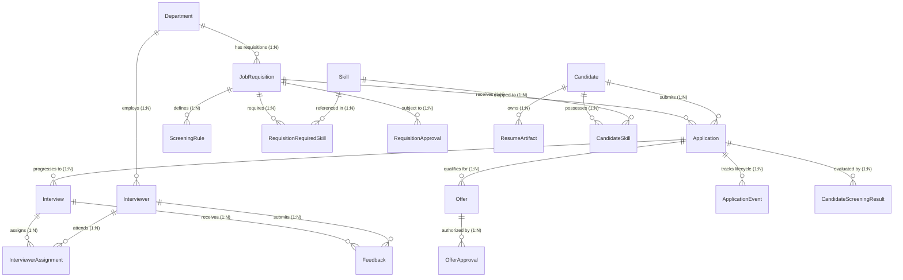
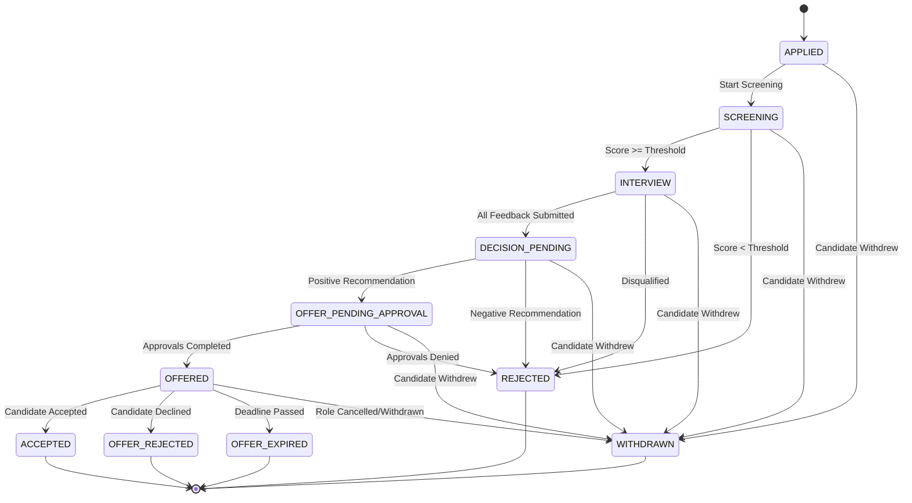

# Entity Relationships and Architecture

## 1. Architectural Relationship Matrix

---

## 2. Cardinality and Foreign Key Specification

### A. One-to-Many Relationships (1:N)
1. **`Department` -> `JobRequisition`**
   - Foreign Key: `job_requisitions.department_id` references `departments.id`
   - Delete rule: `RESTRICT` (A department cannot be deleted if active requisitions exist).
2. **`Department` -> `Interviewer`**
   - Foreign Key: `interviewers.department_id` references `departments.id`
   - Delete rule: `RESTRICT`.
3. **`JobRequisition` -> `Application`**
   - Foreign Key: `applications.requisition_id` references `job_requisitions.requisition_id`
   - Delete rule: `RESTRICT`.
4. **`Candidate` -> `Application`**
   - Foreign Key: `applications.candidate_id` references `candidates.candidate_id`
   - Delete rule: `RESTRICT`.
5. **`Candidate` -> `ResumeArtifact`**
   - Foreign Key: `resume_artifacts.candidate_id` references `candidates.candidate_id`
   - Delete rule: `CASCADE`.
6. **`JobRequisition` -> `ScreeningRule`**
   - Foreign Key: `screening_rules.requisition_id` references `job_requisitions.requisition_id`
   - Delete rule: `CASCADE`.
7. **`Application` -> `CandidateScreeningResult`**
   - Foreign Key: `candidate_screening_results.application_id` references `applications.application_id`
   - Delete rule: `CASCADE`.
8. **`Application` -> `Interview`**
   - Foreign Key: `interviews.application_id` references `applications.application_id`
   - Delete rule: `CASCADE`.
9. **`Interview` -> `Feedback`**
   - Foreign Key: `feedback.interview_id` references `interviews.interview_id`
   - Delete rule: `CASCADE`.
10. **`Interviewer` -> `Feedback`**
    - Foreign Key: `feedback.interviewer_id` references `interviewers.interviewer_id`
    - Delete rule: `RESTRICT`.
11. **`Application` -> `Offer`**
    - Foreign Key: `offers.application_id` references `applications.application_id`
    - Delete rule: `CASCADE`.
12. **`Offer` -> `OfferApproval`**
    - Foreign Key: `offer_approvals.offer_id` references `offers.offer_id`
    - Delete rule: `CASCADE`.
13. **`Application` -> `ApplicationEvent`**
    - Foreign Key: `application_events.application_id` references `applications.application_id`
    - Delete rule: `CASCADE`.

---

### B. Many-to-Many Relationships (N:M) Supported by Bridge Tables

1. **`Candidate` <-> `Skill`**
   - Bridge Table: `candidate_skills`
   - Attributes: `proficiency_level` (1..5), `years_experience`
   - Unique Constraint: `(candidate_id, skill_id)`
2. **`JobRequisition` <-> `Skill`**
   - Bridge Table: `requisition_required_skills`
   - Attributes: `is_required` (Boolean), `min_experience_years`
   - Unique Constraint: `(requisition_id, skill_id)`
3. **`Interview` <-> `Interviewer`**
   - Bridge Table: `interviewer_assignments`
   - Attributes: `assigned_at`
   - Unique Constraint: `(interview_id, interviewer_id)`
   - Allows panels with multiple interviewers per round and checks for conflicting bookings.

---

## 3. State Transition Matrix (Application Lifecycle)

### Transition Enforcement Rules:
1. **Screening to Interview**: Requires an active screening rule and an evaluated score meeting or exceeding `passing_threshold`.
2. **Interview to Decision Pending**: Requires every assigned interviewer on all scheduled interview rounds to submit completed `feedback`. Missing feedback blocks transition.
3. **Decision Pending to Offer Pending Approval**: Requires average feedback rating >= 3.0 and at least one positive recommendation (`HIRE` or `STRONG_HIRE`) with no `STRONG_NO_HIRE`.
4. **Offer Pending Approval to Offered**: Requires explicit `APPROVED` status in `offer_approvals`. If out-of-band salary is detected, `exception_approved_by` must be populated.
5. **Requisition Status Coherence**: An offer cannot be extended or an application advanced on a `CLOSED` or `CANCELLED` requisition.
